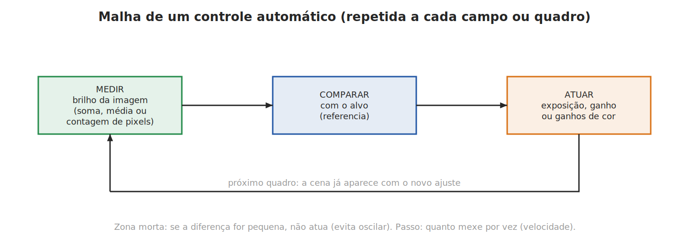
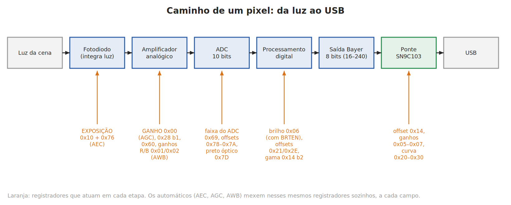
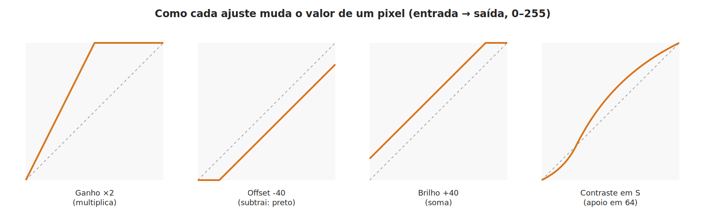
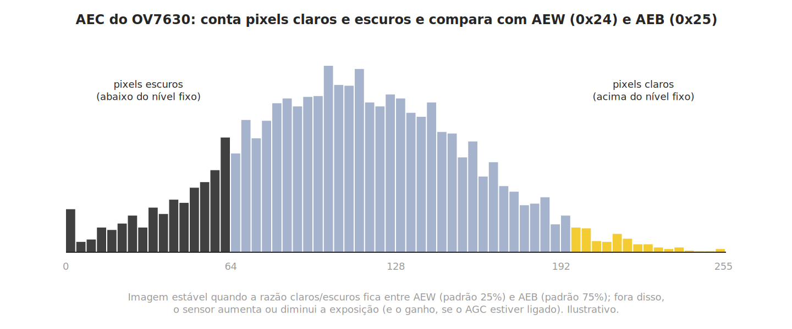
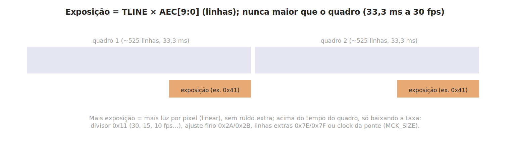
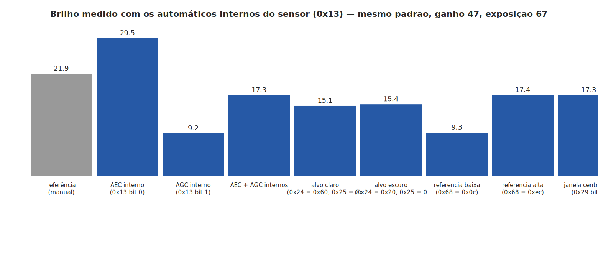
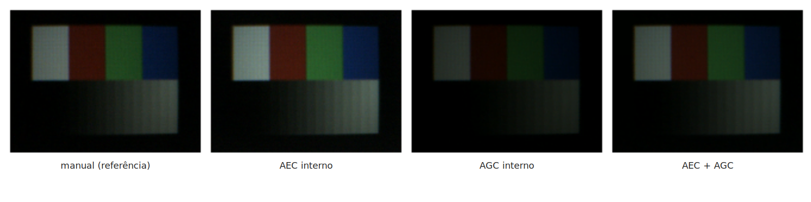
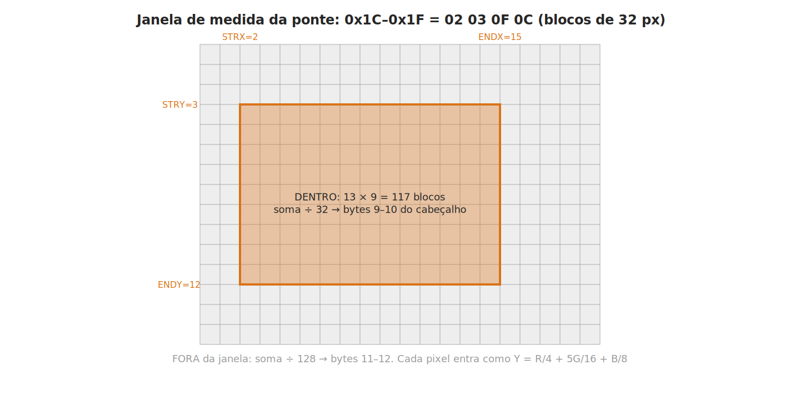

# Capítulo 1 — Controles automáticos: exposição, ganho, balanço de branco e afins

Este capítulo explica os ajustes **automáticos** que existem na câmera Elgin (ponte SN9C103 + sensor OV7630): o que são, como decidem, onde atuam no caminho do pixel, quais registradores os controlam, quais valores servem de referência e o que foi medido na câmera real.

**Legenda das fontes** usada em todo o manual:
**[datasheet]** documento do fabricante (OV7630 v1.7 para o sensor; SN9C102 v0.9 para a ponte, por falta do mapa do SN9C103) ·
**[Windows]** valor gravado pelo driver original do Windows (captura USB) ·
**[medido]** testado nesta câmera, com o arquivo do teste indicado ·
**[hipótese]** dedução ainda não confirmada.

---

## 1.1 O que é um controle automático

Um controle automático é uma **malha fechada**: a cada imagem, ele **mede** algo (o brilho, a cor), **compara** com um **alvo** (a referência) e **atua** em um ajuste (exposição, ganho, ganhos de cor). A imagem seguinte já sai com o ajuste novo, e o ciclo se repete.

Três ideias aparecem em todos os automáticos:

- **Alvo (referência):** o valor que se quer atingir — por exemplo, "metade dos pixels claros, metade escuros" ou "a média da imagem em 51".
- **Zona morta:** uma faixa em volta do alvo em que o controle **não atua**. Sem ela, a imagem oscila (clareia, escurece, clareia…).
- **Passo e ritmo:** quanto o controle muda de cada vez e a cada quantas imagens. Passos grandes chegam rápido ao alvo, mas podem oscilar; passos pequenos são estáveis, mas lentos.

Na câmera há automáticos em **dois lugares**:

1. **No sensor OV7630**, dentro do chip: exposição (**AEC**), ganho (**AGC**), balanço de branco (**AWB**), brilho automático e calibração do preto. O sensor mede a própria imagem e reescreve sozinho os seus registradores.
2. **No driver** (software no computador), usando a **medida de luz** que a ponte envia em cada quadro. A ponte **mede**, mas **não atua**: quem decide é o driver.

---

## 1.2 Onde cada ajuste age sobre o pixel

O valor que chega ao computador para cada pixel passa por esta sequência:

| Etapa | O que acontece | Ajustes que agem aqui |
|---|---|---|
| **Fotodiodo** | Acumula a luz durante o **tempo de exposição** | Exposição: `0x10` + `0x76` bits 1:0 (AEC) |
| **Amplificador analógico** | Multiplica o sinal elétrico **antes** da conversão | Ganho `0x00` (AGC), +3 dB `0x28` bit 1, pré-amplificadores `0x60`, ganhos R/B `0x01`/`0x02` (AWB) |
| **ADC (conversor)** | Converte o sinal em número de 10 bits, até 12 MHz [datasheet] | Faixa e referência do ADC `0x69`, offsets do ADC `0x78`–`0x7A`, preto óptico `0x7D` |
| **Processamento digital do sensor** | Ajustes numéricos sobre o valor convertido | Brilho `0x06` (com `0x61` bit 3), offsets `0x21`/`0x2E`, gama `0x14` bit 2 |
| **Saída Bayer** | 8 bits por pixel, um valor de cor por posição do mosaico | — |
| **Ponte SN9C103** | Recorta, ajusta, reduz e comprime | Offset `0x14`, ganhos `0x05`–`0x07`, curva `0x20`–`0x30` |

**Por que a ordem importa:**

- **Exposição** aumenta o sinal **sem** aumentar o ruído eletrônico — é sempre a primeira escolha quando falta luz. Seu limite é o tempo do quadro.
- **Ganho analógico** multiplica o sinal **e o ruído** antes do ADC; ainda aproveita bem a resolução do conversor.
- **Ganho digital** (na ponte) multiplica números já convertidos: além do ruído, "espaça" os níveis — com ganho 2×, só sobram valores pares, por exemplo.
- **Offset e brilho** somam ou subtraem um valor fixo; **curva** (gama, contraste) redistribui os tons.

**Faixa da saída crua:** o datasheet diz que a saída RGB crua vai de **16 a 240** (0 e 255 reservados para sincronismo) [datasheet]. O bit `0x27` bit 1 (COMG, "faixa completa") a estende para 1–254; o valor do Windows, `0x27 = 0x9A`, tem esse bit **ligado** [Windows].

**Decibéis (dB):** o ganho costuma ser dado em dB: `ganho em dB = 20 × log10(fator)`. Assim, +6 dB ≈ 2×, +12 dB ≈ 4×, **+24 dB ≈ 16×** (o máximo do AGC do OV7630 [datasheet]) e +3 dB ≈ 1,41×.

---

## 1.3 Glossário rápido

| Termo | Significado |
|---|---|
| **AEC** | *Automatic Exposure Control* — exposição automática: o sensor escolhe o tempo de exposição |
| **AGC** | *Automatic Gain Control* — ganho automático: o sensor escolhe o ganho analógico |
| **AWB** | *Automatic White Balance* — balanço de branco automático: o sensor ajusta os ganhos de vermelho e azul para que o branco saia branco |
| **BLC / preto óptico** | *Black Level Calibration* — calibração do preto usando pixels da borda da matriz cobertos de metal (não recebem luz) |
| **Exposição / TLINE** | Tempo que o pixel acumula luz. No OV7630 é contado em **linhas**: `TEX = TLINE × AEC[9:0]` [datasheet] |
| **Campo / quadro** | O sensor lê a matriz em dois campos (linhas ímpares e pares); dois campos formam um quadro |
| **Banda / cintilação** | Faixas escuras que andam na imagem sob luz fluorescente (que pisca a 100/120 Hz) |
| **IRE** | Unidade de nível de vídeo (0 = preto, 100 = branco) usada como referência do brilho automático |
| **Zona morta** | Faixa em volta do alvo em que o automático não age |
| **Cabeçalho do quadro** | 18 bytes que a ponte coloca antes de cada imagem; trazem a medida de luz (seção 1.8) |

---

## 1.4 AEC — exposição automática do sensor

### O que faz

Escolhe o **tempo de exposição** para que a imagem não fique nem escura nem estourada. Com o AEC ligado, o sensor **reescreve sozinho** o registrador de exposição (`0x10` e `0x76` bits 1:0) a cada campo [datasheet].

### Como decide

Segundo o datasheet, o algoritmo **conta os pixels claros e escuros da imagem inteira** (acima e abaixo de níveis fixos) e compara a proporção com duas referências: **AEW** (`0x24`) e **AEB** (`0x25`). A imagem é considerada estável quando a proporção de claros e escuros fica dentro da faixa definida por elas [datasheet]. A otimização supõe uma cena "normal", com o assunto bem iluminado em relação ao fundo; para outras cenas, o datasheet recomenda ajustar essa razão.

### A exposição dentro do quadro

- O valor `AEC[9:0]` tem 10 bits: os 8 altos em `0x10` e os 2 baixos em `0x76` bits 1:0 [datasheet].
- O tempo de exposição é `TLINE × AEC` [datasheet]; a exposição nunca passa do tempo do quadro. A 30 fps, um quadro dura 33,3 ms. [hipótese] Pelo tamanho de uma "linha extra" medida com `0x7E`/`0x7F` (~66 µs por unidade), TLINE fica perto de 63–66 µs.
- O driver usa como exposição máxima útil `0x10 = 0x41` (valor do datasheet citado no código herdado do gspca) e converte o controle `exposure` (em unidades de 0,5 ms) para esse registrador.
- Para expor **mais** que um quadro, só baixando a taxa: divisor `0x11`, ajuste fino `0x2A`/`0x2B`, linhas extras `0x7E`/`0x7F` ou o clock que a ponte fornece (`0x17` + `MCK_SIZE` no `0x19`). Ver o capítulo de taxa de quadros.

### Registradores do AEC

| Registrador | Bits | Função | Padrão [datasheet] | Nesta câmera |
|---|---|---|---|---|
| `0x13` COMB | 0 | **Liga o AEC** | 1 | **0** (driver grava `0x80`) |
| `0x10` AEC | 7:0 | Exposição, bits 9:2 (escrita pelo AEC quando ligado) | 0x41 | controle `exposure` |
| `0x76` COMO | 1:0 | Exposição, bits 1:0 | 01 | 00 [Windows] |
| `0x24` AEW | 7:0 | Proporção de pixels **claros** (padrão 25%; 1,3%/passo entrelaçado, 0,7% progressivo; faixa 0x01–0x9A). Maior = imagem mais clara | 0x10 | 0x10 |
| `0x25` AEB | 7:0 | Proporção de pixels **escuros** (padrão 75%). Maior = imagem mais escura. Regra: AEW + AEB > 0x9A | 0x8A | 0x8A |
| `0x68` ARL | 7:5 | Tensão de referência do AEC/AGC: maior = imagem final mais clara | 0xAC | 0xAC |
| `0x29` COMI | 3 | 1 = mede só o **quarto central** da imagem | 0 | 0 (0x30 [Windows]) |
| `0x2A` FRARH | 0 | 1 = usa a **média** de luminância interna em vez da contagem de pixels | 0 | 0 |
| `0x2D` COMJ | 7 | Ritmo: 1 = atualiza a cada 2 ou 4 campos; 0 = a cada campo | 1 | 1 |
| `0x28` COMH | 4 | **Congela** o AEC/AGC (mantém `0x00` e `0x10`) | 0 | 0 |
| `0x15` COMD | 3, 2 | Modo AEC rápido (bit 2) e passo grande (bit 3) | 0 | 0 |
| `0x77` AEGR | 7:4, 3:0 | Limiares do modo rápido (como AEW/AEB) | 0xF3 | — |
| `0x75` COMN | 3, 2 | Bit 3: descarta um quadro quando a exposição muda muito; bit 2: permite exposição menor que 1/120 s no modo suave | — | 0x8E [Windows] |
| `0x1F` SOFT | 5 | Intervalo maior entre passos do AEC/AGC abaixo de 8 linhas | 0 | 0 |

### Filtro de banda (cintilação)

Sob luz fluorescente, a luz pisca a 100 Hz (rede de 50 Hz) ou 120 Hz (60 Hz). Se a exposição não for múltipla desse período, aparecem faixas. O OV7630 tem um modo do AEC que só escolhe exposições "seguras": `0x2D` bit 2 (BANDF) [datasheet], com a opção de clock em `0x13` bit 6. **Só funciona com o AEC ligado**: com a exposição manual, o bit não teve efeito [medido, `varre_bits.py`]. O driver trata a cintilação ajustando a taxa pelo `0x2B` (controle `power_line_frequency`).

### O que foi medido

Teste `testes/testa_combina.py` (2026-10-17): padrão composto na tela, ganho 47 e exposição 67 manuais como ponto de partida [medido].

- **AEC ligado** (`0x13 = 0x81`): brilho **21,7 → 29,5** — o sensor escolheu uma exposição maior.
- **AEC + AGC** (`0x13 = 0x83`): 17,3 — o sensor escolhe o próprio par exposição/ganho.
- **Referência `0x68` baixa** (0x0C): 9,3 (mais escuro); alta (0xEC): igual ao padrão.
- **Alvos `0x24`/`0x25`** e **janela central** (`0x29` bit 3): quase sem efeito nesta cena.

**Situação no driver:** desligado. Desde 2026-10-17 a exposição é **manual** (controle `exposure`). Para usar o AEC do sensor, basta `0x13 = 0x81` (ou `0x83` com o AGC); enquanto estiver ligado, o controle `exposure` perde o efeito, porque o sensor reescreve o `0x10`.

---

## 1.5 AGC — ganho automático do sensor

### O que faz

Escolhe o **ganho analógico** (`0x00`) para compensar a falta de luz quando a exposição já não basta. Com o AGC ligado, o sensor reescreve o `0x00` sozinho; com ele desligado, o `0x00` guarda o valor manual [datasheet]. O ganho máximo é de **+24 dB (16×)** [datasheet].

### Registradores do AGC

| Registrador | Bits | Função | Nesta câmera |
|---|---|---|---|
| `0x13` COMB | 1 | **Liga o AGC** | 0 |
| `0x12` COMA | 5 | AGCEN — também habilita o AGC [datasheet] | 1 (`0x78`/`0x7C`) |
| `0x00` GAIN | 5:0 | Ganho atual (escrito pelo AGC quando ligado) | controle `gain` (0–47) |
| `0x28` COMH | 1 | **+3 dB** em todos os canais | 0 |
| `0x60` SPCA | 7 | Pré-amplificador **1,5×** | 0 (`0x29` [Windows]) |
| `0x61` SPCB | 7 | Realimentação do AGC/AEC pelo canal Y — **deve ser 0 em RGB** [datasheet] | 0 |
| `0x68` ARL | 7:5 | Referência comum do AEC/AGC | 0xAC |

**Curiosidade do ganho do OV7630:** no valor 32 o ganho volta ao nível de 16; por isso o driver (como o `sonixb` do kernel) pula a faixa 32–47 da escala 0–63, e o controle `gain` vai de 0 a 47 [código do sonixb].

### O que foi medido

- **AGC ligado** (`0x13 = 0x82`): brilho **21,7 → 9,2** — o sensor escolheu um ganho **menor** que o manual (47) [medido].
- Ganho manual: os bits 5–2 do `0x00` mudam claramente o brilho; zerar o bit 5 leva 23,5 → 9,5 [medido, `varre_bits.py`].
- `0x28` bit 1 (+3 dB): 21,7 → 39,1; `0x60` bit 7 (1,5×): 21,7 → 35,8 [medido].

---

## 1.6 AWB — balanço de branco automático do sensor

### O que é

A cor da luz muda com a fonte: lâmpada incandescente é amarelada, o céu nublado é azulado. O **balanço de branco** multiplica os canais vermelho e azul para que um objeto branco saia branco (R ≈ G ≈ B). O AWB faz isso sozinho: mede a cor média da cena e ajusta os ganhos **BLUE** (`0x01`) e **RED** (`0x02`) [datasheet].

### Como decide

O AWB supõe que a cena, em média, é cinza. Ele compara os canais e corrige até atingir a proporção-alvo dada pelos registradores de "fundo" **ABLU** (`0x0C`) e **ARED** (`0x0D`) — maiores = imagem mais azulada / mais avermelhada [datasheet]. No **modo esperto**, ignora pixels muito escuros ou muito claros (que enganam a média) [datasheet].

### Registradores do AWB

| Registrador | Bits | Função | Padrão [datasheet] | Nesta câmera |
|---|---|---|---|---|
| `0x12` COMA | 2 | **Liga o AWB** | 1 | 1 (controle `white_balance_automatic`) |
| `0x01` BLUE | 7:0 | Ganho do azul (escrito pelo AWB) | 0x80 | 0x77 [Windows] |
| `0x02` RED | 7:0 | Ganho do vermelho (escrito pelo AWB) | 0x80 | 0x3A [Windows] |
| `0x0C` ABLU | 5:0 | Alvo do azul (0x3F = mais azul) | 0x20 | 0x20 |
| `0x0D` ARED | 5:0 | Alvo do vermelho | 0x20 | 0x20 |
| `0x14` COMC | 7 | Limiar: 1 = mais estável, 0 = mais preciso | 0 | 1 (`0x80`) |
| `0x15` COMD | 5:4 | Passo: 00 = 1 bit (256 passos), 10 = 2 bits, 01/11 = 4 bits | 00 | 11 (`0x34` [Windows]) |
| `0x20` COME | 1 | AWB sempre rápido (ganhos mudam a cada campo) | 0 | 0 |
| `0x20` COME | 2 | Permite ajuste manual com o AWB ligado | 0 | gravado 1 (`0x44` [Windows]), lido 0 |
| `0x20` COME | 3 | Modo esperto (ignora pixels fora da faixa do `0x66`); só com AEC e AWB ligados | 0 | 0 |
| `0x66` AWBC | 7:0 | Faixas de luminância e de U/V aceitas pelo modo esperto | 0x55 | 0x55 |
| `0x70` COMK | 1 | Modo lento: 1 = atualiza a cada 64 campos, 0 = a cada 16 | 0 | 1 (`0x0B` [Windows]) |

### O que foi medido

- Desligar o AWB (`0x12 = 0x78`): o azul do branco passou de 90 para 101 — **efeito pequeno** nesta cena [medido].
- Alvos `0x0C`/`0x0D`: mudam a cor (cada bit alto mexe nas posições da sua cor) [medido, `varre_bits.py`].
- Modos do `0x20` e passo do `0x15`: efeitos pequenos [medido].

**Situação no driver:** AWB **ligado** por padrão. Desligado, o driver devolve `0x01`/`0x02` aos valores do Windows (0x77/0x3A). Os controles dos alvos foram retirados em 2026-10-17 (ficam em 0x20).

---

## 1.7 Brilho automático, preto automático e medidor de luz do sensor

### Brilho automático

O OV7630 pode ajustar sozinho o **brilho** (`0x06`) pela proporção de pixels abaixo de um nível de referência: se houver pixels escuros demais, ele baixa o brilho; se de menos, aumenta [datasheet].

| Registrador | Bits | Função |
|---|---|---|
| `0x2C` EXBK | 7:4, 3:0 | Faixas de proporção (0,06% a 3,85%) que definem quando o brilho sobe ou desce |
| `0x61` SPCB | 1:0 | Nível de referência: 0, 6, 10 ou 20 IRE |
| `0x61` SPCB | 3 | **BRTEN** — liga o brilho RGB (sem ele o `0x06` não age em cru [medido]) |

Na varredura bit a bit, o `0x2C` **não teve efeito** visível [medido].

### Preto automático (calibração do nível de preto)

A matriz do sensor tem pixels nas bordas **cobertos por metal**: eles não recebem luz e mostram o "preto verdadeiro" do momento (que muda com a temperatura). O sensor usa essas **linhas de preto óptico** para corrigir o nível de preto de toda a imagem [datasheet].

| Registrador | Bits | Função | Nesta câmera | Medido |
|---|---|---|---|---|
| `0x7D` COMP | 6, 7 | Liga a linha de preto óptico (6) e a usa na calibração (7) | ligados (`0xF7` [Windows]) | desligar → imagem **mais clara** (21,7 → 32) |
| `0x23` CLKC | 4 | Atualiza automaticamente o preto óptico (`0x1E`) | 0 (`0xEE`) | — |
| `0x26` COMF | 0 | Envia as primeiras 4/8 linhas de preto antes da imagem | 0 | — |
| `0x2D` COMJ | 4 | Expansão automática do preto | 0 | sem efeito |
| `0x26` COMF bit 1 + `0x27` COMG bit 2 = 0 | — | Offsets digitais `0x21`/`0x22`/`0x2E` calculados pelo circuito interno | desligado | sem efeito |
| `0x27` COMG | 3 | Liga a calibração do ADC com os offsets `0x78`–`0x7A` | ligado (`0x9A`) | — |

### Medidor de luz do sensor

`0x7C` (AVG) guarda a **média de luminância** do campo ou quadro quando `0x20` bit 6 está ligado [datasheet]. O valor do Windows (`0x20 = 0x44`) liga esse bit. Ainda **não foi lido** nos testes.

---

## 1.8 A ponte SN9C103: a medida de luz em cada quadro

A ponte **não tem automático próprio** — não muda exposição nem ganho sozinha. Mas ela **mede** a luz de cada quadro e envia o resultado junto com a imagem, para que o driver decida.

### A janela de medida (`0x1C`–`0x1F`)

| Registrador | Nome | Bits úteis [medido] | Unidade |
|---|---|---|---|
| `0x1C` | AE_STRX — início horizontal | 2:0 (0–7) | 32 pixels |
| `0x1D` | AE_STRY — início vertical | 2:0 (0–7) | 32 linhas |
| `0x1E` | AE_ENDX — fim horizontal | 4:0 (0–31) | 32 pixels |
| `0x1F` | AE_ENDY — fim vertical | 3:0 (0–15) | 32 linhas |

O valor do Windows e do driver Risolia é **`02 03 0F 0C`**: de (64, 96) a (480, 384) numa imagem de 640×480, ou seja, **13 × 9 = 117 blocos** de 32×32 [Windows]. O driver usa janelas próprias em alguns modos (60 fps: `01 02 07 06`; CIF: `02 02 09 07`).

### O cabeçalho do quadro (18 bytes no SN9C103)

A ponte põe um cabeçalho **no começo de cada quadro**, dentro do próprio fluxo de vídeo (não é lido por registrador). O driver o encontra procurando a assinatura `FF FF 00 C4 C4 96` [documentação do driver Risolia].

| Bytes | Conteúdo |
|---|---|
| 0–5 | Assinatura `FF FF 00 C4 C4 96` |
| 6, 7 | Ganhos R e B da ponte (bits 6:0; ganho = ½ + valor/64) |
| 8 | Bit 0 compressão · bits 2:1 escala · bit 3 FIFO USB (2 KB) cheio · **bit 4 "ganho digital pronto"** · **bit 5 "exposição pronta"** · bits 7:6 índice do quadro |
| **9–10** | **Soma de Y dentro da janela** (Y = R/4 + 5G/16 + B/8, dividido por 32) |
| **11–12** | **Soma de Y fora da janela** (dividido por 128) |
| 13–17 | Áudio (o SN9C103 tem microfone) |

- A soma é feita **pelo hardware** enquanto os pixels passam; ler o valor não custa nada ao driver.
- [hipótese] Como o cabeçalho vem **antes** dos pixels e a ponte só tem 2 KB de memória, a soma deve se referir ao **quadro anterior** — um quadro de atraso, irrelevante para os automáticos.
- Os bits 4 e 5 do byte 8 sugerem um modo de exposição da própria ponte; o uso deles **não é conhecido** [hipótese].
- A soma é **proporcional à área** da janela: mudar a janela sem recalcular a área (`ae_area` no driver) invalida a medida.

### Converter a soma em tom médio

O driver estima o **tom médio da cena** (0–255) por

**tom ≈ soma × 118 / (área × 256)**  (≈ 0,46 × soma ÷ área).

Calibração inicial: com a soma de 13 000 na janela de 117 blocos, a média medida na janela foi ~51 [medido, 2026-10-11].

---

## 1.9 Automáticos feitos pelo driver

| Automático | Mede | Atua em | Situação |
|---|---|---|---|
| **Contraste adaptativo** | Tom médio da cena (cabeçalho) | Curva da ponte `0x20`–`0x30` | **Ativo** |
| **Trava de banda** (`exposure_dynamic_framerate`) | Tamanho dos quadros comprimidos × banda USB | Taxa (`0x11`) | **Ativa** |
| Ganho/exposição automáticos do driver | Soma do cabeçalho | `0x00`, `0x10`, `0x11` | **Removido em 2026-10-17** |

### Contraste adaptativo

A cada quadro, o driver calcula o tom médio **p** e monta uma **curva em S** de 17 pontos, gravada na tabela da ponte (`0x20`–`0x30`):

- abaixo de p: `y = p·x / (k·p − (k−1)·x)`; acima de p, o espelho da mesma fórmula;
- 0 continua 0 e 255 continua 255; no ponto p, a inclinação é **k**;
- k vem do controle `contrast`: 128 → k = 1 (sem mudança), 255 → k = 3, 0 → k = 1/3;
- a curva só é regravada quando p muda mais de 8 níveis, no máximo a cada 10 quadros.

Assim, aumentar o contraste escurece os tons abaixo do médio e **clareia** os de cima, sem levar a imagem toda para o escuro.

### O ganho automático antigo do driver (registro histórico)

Até 2026-10-17 o driver tinha um automático próprio: comparava a soma do cabeçalho com um alvo (13 000, ajustado pela área e pelo controle "AE target"), com zona morta de ±1 500, e subia primeiro o ganho até o padrão, depois a exposição até o "joelho" e por fim o ganho até 90% — sem nunca baixar a taxa. Foi removido a pedido do Josemar; ganho e exposição são manuais.

---

## 1.10 Valores de referência — resumo

| Automático | Liga | Mede | Alvo / referência | Atua em | Hoje |
|---|---|---|---|---|---|
| **AEC** (sensor) | `0x13` bit 0 | Contagem de pixels claros/escuros (imagem toda ou quarto central) | AEW `0x24`, AEB `0x25`, ARL `0x68` | Exposição `0x10`/`0x76` | Desligado |
| **AGC** (sensor) | `0x13` bit 1 (+ `0x12` bit 5) | A mesma do AEC | ARL `0x68` | Ganho `0x00` | Desligado |
| **AWB** (sensor) | `0x12` bit 2 | Cor média (modo esperto: só tons médios) | ABLU `0x0C`, ARED `0x0D` | `0x01` (B), `0x02` (R) | Ligado |
| **Brilho automático** (sensor) | — | Pixels abaixo da referência | EXBK `0x2C`, `0x61` bits 1:0 | Brilho `0x06` | Sem efeito medido |
| **Preto óptico** (sensor) | `0x7D` bits 7/6 | Pixels cobertos da borda | Preto = 16 | Nível de preto | Ligado |
| **Medida da ponte** | sempre | Soma de Y na janela `0x1C`–`0x1F` | — | (nada; o driver usa) | Ativa |
| **Contraste adaptativo** (driver) | `contrast` ≠ 128 | Soma da ponte | Tom médio da cena | Curva `0x20`–`0x30` | Ativo |
| **Trava de banda** (driver) | `exposure_dynamic_framerate` | Tamanho dos quadros | 90% / 80% da banda USB | Taxa `0x11` | Ativa |

---

*Fontes deste capítulo:* `NOTAS_REGISTRADORES.md` (seções "Varredura bit a bit do sensor", "Testes de combinação", "Brilho real…", "Varredura das fontes"), `MAPA_REGISTRADORES.html`, `CHIP_INFO/OV7630-unlocked.pdf`, `CHIP_INFO/sn9c102_registers.pdf`, `sn9c1xx/modified/sn9c102.txt` e o código `elgin_fps.c`.
